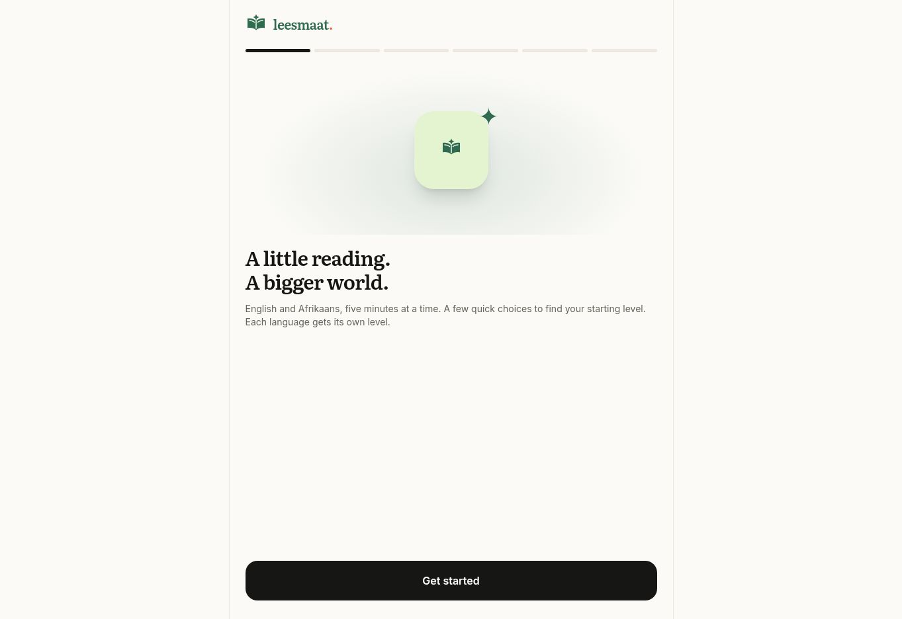

# Leesmaat

English and Afrikaans reading practice in short sessions, with bookmarks, placement and an offline reading archive.

**[Explore the live application](https://leesmaat.vercel.app/)** · [Browse the source](https://github.com/thembaxx/leesmaat)

## Engineering highlights

Account-free local reading, IndexedDB downloads and optional Firebase Google sync with per-user access rules.

## Technology

Declared in [package.json](package.json): Next.js `16.4.0` · React `^19.3.0` · TypeScript `^7.0.2` · Tailwind CSS `^4.3.3` · Three.js `^0.186.1` · Firebase `^13.0.0` · WebLLM `0.2.85` · Zod `^4.6.5`.

**Quality tooling:** `typecheck`, `lint`, `format:check`, `test`, `test:e2e` scripts are available. See the setup guide below for prerequisites; this documentation pass does not assert that those checks were run.

## Application preview



Captured from the live application on 17 October 2026. [Capture details and limitations](docs/screenshots/README.md).

---

## Project guide

English and Afrikaans literacy, five minutes at a time. Next.js App Router, TypeScript, Tailwind v4 and Phosphor icons, with optional Google sync and an offline reading archive.

## Run

Use Node 24 and pnpm 11.25.0 (declared in `package.json`).

```sh
pnpm install
pnpm dev
```

The home, reader, practice, bookmarks and placement screens work without any account or backend. The floating navigation keeps three icon-only destinations.

```sh
pnpm format
pnpm lint
pnpm typecheck
pnpm test
pnpm build
pnpm start
```

Offline caching runs in production (`pnpm build && pnpm start`), on localhost or HTTPS. Development deliberately does not register a worker. Visiting either the app or a public library page prepares the app shell; the first public title is saved during worker installation too. Open a reading's settings and choose **Download offline** to keep its complete text and source-edition cover. The **Archive** tab in Bookmarks lists real IndexedDB downloads. Reload offline to verify the shell, reading, artwork, words and notes remain available. In iOS Safari, use Share → Add to Home Screen; other supporting browsers offer installation from their menu.

## Enable Google sync

1. Create a Firebase project and register a web app. Enable **Authentication → Google** and create a **Cloud Firestore Standard edition** database.
2. Copy `.env.example` to `.env.local` and fill in the four public web-app config values. No service account or client secret belongs in this repository. Configure the same variables on your host **before building**; Next embeds these public values in its client bundle.
3. Add localhost and the deployed domain under Authentication's **Authorized domains**. The Firebase project's auth domain must match the web-app configuration.
4. Deploy the provided rules to that project:

   ```sh
   pnpm exec firebase deploy --only firestore:rules --project YOUR_PROJECT_ID
   ```

   Use your own authenticated Firebase CLI connection for this administrative setup. Keep the supplied rules; test-mode rules expose reading data.

5. Rebuild and open Settings → **Continue with Google**. A second browser signed into the same Google account receives progress, language levels, preferences, bookmarks, words, anchored notes and review schedules. Signing out keeps the local library.

Each learner owns `/users/{uid}/state/reading`; the rules deny anonymous and cross-account access. Every logical setting or collection entry has a timestamp and device tie-breaker. Firestore transactions merge clocks before saving, and tombstones preserve deletions. Download IDs and content remain device-local. Local changes survive failed sign-in, loss of connectivity and reload, and upload when reconnected. There is a short debounce to avoid a write every reading second. Simultaneous edits to the same entry resolve to the latest clock; reading seconds and XP use this same rule rather than adding concurrent sessions together. Device clocks should be correct.

The Firebase public configuration has not been supplied with this project. Sign-in is intentionally unavailable until the project owner enables the service; the rest of Leesmaat continues to work.

## Learning and content

- Separate placement and levels for English and Afrikaans: sentence comfort, vocabulary and inference.
- Saved-word review intervals of 1, 3, 6 days, then progressively longer up to 60 days. Missed words return after ten minutes. Auto study generates exact-source recall questions for the selected book chapter, scene, poem, story or essay. Answers schedule reviews and award XP once per completed session. Main talking points are available while studying.
- Choose downloadable English Piper voices or compact Afrikaans eSpeak-NG variants in Settings → Reading voice. Preview recordings, filter gender/country, inspect model and shared-engine sizes, and try custom text after downloading. Generated speech stays on device and works offline; device voices remain available as a fallback. Sentence highlighting follows generated audio; word highlighting is available when system voices provide boundary events. See [VOICE.md](VOICE.md) for research and licensing.
- Source-range notes highlight the actual selected words. Prototype notes without a range are preserved in Bookmarks.
- Reader search supports phrases, match counts and previous/next matches. Paper, sepia, night, monochrome, font size, speed and zen controls are included.
- Smart summaries add a brief overview, main talking points and links to highlighted supporting passages. Available on longer reader entries and public title pages, in the text’s language, including offline. Short poems and stories stay focused on the text. Book previews and individual chapters have explicit coverage labels. Edited summaries are matched to exact source versions; other longer content uses paragraph-aware key-sentence extraction. No model API or account is needed, and archived copies are summarized from their own text. Public text and LLM endpoints include the same summaries.
- A daily goal awards once per day; a completion celebration respects reduced motion.
- The verified Grade 12 HL/FAL literature list covers the 2026 exam period. Grade 10–11 entries come from the current DBE FET literature catalogue and are labelled catalogue selections: confirm the school's chosen texts.
- The catalogue prioritises **books, poems, short stories, articles**. It includes 45 sourced public-domain works: 15 complete books, 18 poems, nine short stories and three essays. Book chapters load on demand; offline downloads preserve the whole book. Modern setworks have verified title/author/ISBN records and library links. Actual source-edition covers replace generated imagery where available; remaining titles use typography. Earlier original readings remain reachable through saved links. Real Wiktionary dictionary cards show IPA, part of speech, numbered definitions, examples and attribution, using self-hosted Roboto and Noto Serif. Afrikaans entries include English definitions and a 9,150-entry offline snapshot; English lookups are cached after use. See [CONTENT.md](CONTENT.md) for sources and rights.

## Verification

```sh
pnpm test              # migration, conflict merging, anchors, goals, review intervals and content
pnpm test:sync         # Firebase Auth/Firestore emulators; requires Java 21+
pnpm build
pnpm exec playwright install chromium
pnpm test:e2e          # production browser, offline reload, notes, placement, practice and axe checks
```

The sync tests use the isolated `demo-leesmaat` emulator project, including simulated Google credentials, account isolation and two-device transaction merging. They do not use a real Google account. Browser tests run a production server on port 3100. CI runs all of these checks and preserves failure traces. It uses a reserved example origin to verify canonical URLs, social metadata and the complete sitemap. Workspace overrides keep Firebase’s Node gRPC transport on the patched compatible v1 release and its CLI’s `gaxios@6` on `uuid@11.1.1`, the patched CommonJS-compatible line. Toolchain tests verify UUID buffer bounds and multipart serialization through the CLI’s actual dependency graph; emulator tests verify the Firebase transport.

Deploy to a Next.js-compatible host with Node support. The build generates `/sw.js` from the actual production JavaScript, CSS and font assets; it caches only public same-origin app files and never auth/API traffic. A newly built worker waits until the reader chooses Update, or until old tabs close. Applying an update reloads controlled tabs while retaining local progress and downloads. Browsers may evict stored files when space is scarce: the archive reconciles with IndexedDB on startup, and downloads can be recreated. Removing an archived read deletes its stored content; artwork is a small shared app asset.

## Brand, PWA and discovery

Leesmaat is the retained name, with the tagline **A little reading. A bigger world.** The open-book and spark mark, wordmark, maskable icons, social image, iPhone/iPad launch images and all covers are reproducible with `pnpm art`. See [BRAND.md](BRAND.md) for the visual direction. Previous cover assets remain available for existing archived downloads.

The onboarding book and floating background use lazily loaded Three.js. Drag the book or use its keyboard-accessible turn/reset buttons. Animation caps pixel density and runs at 30 fps; it pauses outside the active view and when hidden. Reduced motion, data saver and unavailable WebGL retain a static illustration. Three.js is never needed to complete placement.

The installed app supports installation prompts where provided, Safari instructions, app shortcuts, offline status, optional persistent-storage requests and controlled updates. Reader links survive reload and browser Back/Forward; sharing uses Web Share or clipboard fallback. Fullscreen, Media Session controls and a screen wake lock during read-aloud enhance supporting devices. These APIs vary by browser; Downloaded packs provide offline audio; system voice availability varies.

Paper, sepia, night and system themes coordinate the HTML background, safe areas, browser chrome, loading/recovery screens, manifest and supported portrait/landscape iOS launch images. A small inline style and preference script paint the background before the main CSS or hydration is ready; the theme bridge reuses those head tags during hydration. The standalone offline recovery page is generated from `scripts/offline-template.html` using the same startup theme code. Theme-specific manifest URLs keep launch colors available offline and when cookies are blocked; a `leesmaat-theme` preference cookie also supports direct manifest requests. Launch images include pixel density in their filenames so devices with identical CSS screen sizes receive the correct image. Only requested launch images are cached, keeping all other device variants out of the initial offline download. Browsers can retain an older installed launch screen until they refresh app metadata.

Public `/library` and `/library/[id]` pages render without JavaScript, expose real reading text, book chapter indexes, verified catalogue records and attribution, and include per-title descriptions and structured data. `/llms.txt`, `/llm.txt` (alias), `/llms-full.txt` and per-title `/text` endpoints expose public material with rights labels, never private reading data. Per-book plain-text endpoints contain all imported chapters.

Set **NEXT_PUBLIC_SITE_URL** to the production HTTPS origin in `.env.local` and on the host **before building**. This enables canonical URLs, absolute social images, robots sitemap discovery and all current library sitemap entries. The verified production domain defaults to `https://leesmaat.vercel.app`. An explicit empty override omits canonicals and absolute sitemap entries and marks public pages noindex. Origin values with paths, credentials, queries or fragments are rejected. The public library and relative LLM links still work.

Browser verification covers phone, tablet, desktop and landscape layouts, reduced motion, install events, sharing/history, system themes, public content, WCAG checks and a real service-worker update through a local test proxy. Native API behavior still warrants a smoke test on physical iOS and Android devices before release.

## Rebuild content and voices

Imported assets are committed, so normal installation/build needs no source-data downloads. To refresh them deliberately:

```sh
python3 -m pip install beautifulsoup4
pnpm content:import
pnpm dictionary:import
pnpm voices:import
node scripts/build-voice.mjs
pnpm format
pnpm test
```

Content and voice manifests store exact sizes and SHA-256 digests. Generated book JSON, dictionary snapshots and vendored speech engines are excluded from formatting to preserve those digests. A production build regenerates the Piper worker and engine manifest; model weights remain on demand. eSpeak recordings in `public/voice-previews` were generated with the shipped pack.

## Optional offline reading assistant

Settings → **Offline reading assistant** offers a compact Qwen model and Llama 3.2, with exact download sizes, device checks, progress, cancellation and removal. In the reader, the spark action produces chapter/reading talking points; selecting text exposes a passage explanation action. Generation runs locally in a background worker, with supporting links to the actual text. The model reads every bounded passage of the current chapter before reducing its points.

Models are downloaded only on a deliberate click and require compatible WebGPU hardware, storage and roughly 1.1 GB of working graphics memory. Existing summaries and real dictionary definitions remain available on other devices. The shared runtime and large model weights are excluded from the default offline shell. See [OFFLINE-AI.md](OFFLINE-AI.md) for models, licences, privacy, source coverage and validation.
